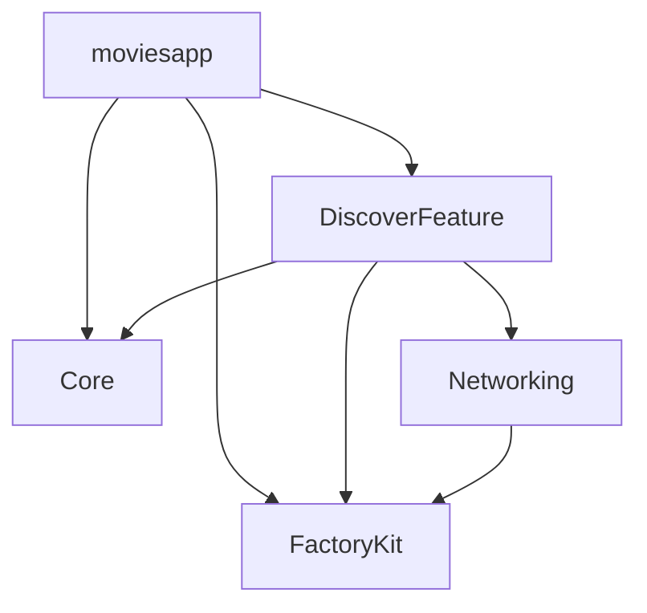
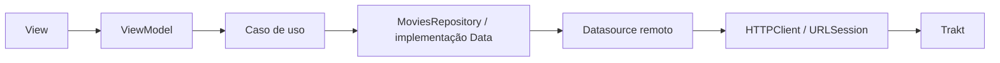

# movieslist

O **movieslist** é um projeto iOS cujo objetivo principal é demonstrar uma base de código estruturada, com separação de responsabilidades, princípios SOLID e arquitetura em camadas inspirada na Clean Architecture. A descoberta de filmes com dados do Trakt serve como contexto para aplicar testes unitários e tecnologias modernas, como SwiftUI, Observation e Swift Concurrency, utilizando `async/await`, `Task` e actors para gerenciar operações assíncronas, concorrência e isolamento de estado.

O projeto começou como uma POC de validação de APIs e evoluiu para uma arquitetura modular organizada por feature. A estrutura atual separa modelos compartilhados, infraestrutura HTTP e a funcionalidade de descoberta, que reúne suas próprias camadas de apresentação, domínio e dados.

## Requisitos

| Requisito | Configuração |
|---|---|
| Xcode | Toolchain compatível com Swift tools 6.4. Ambiente de referência inspecionado: Xcode 27.1, com Apple Swift 6.4. |
| Swift | Modo de linguagem Swift 6 nos pacotes e no App. |
| Destino iOS | Simulador instalado ou dispositivo com iOS 26.6 ou superior, compatível com o Xcode utilizado. |
| Projeto e scheme | `moviesapp.xcodeproj` e scheme `moviesapp`. |
| Dependências | Swift Package Manager: pacotes locais `Core`, `Networking` e `DiscoverFeature`, além de `Factory`/`FactoryKit`. |
| Rede e API | Acesso à internet para resolver dependências e consumir o Trakt; execução live depende de um Client ID válido e acesso ao provedor. |

A raiz do repositório é a pasta que contém `moviesapp.xcodeproj`, `Core/`, `Networking/` e `DiscoverFeature/`. Execute os comandos deste README a partir dela e mantenha os pacotes locais nessa estrutura.

## Como executar

### Abrir e rodar no Xcode

1. Abra `moviesapp.xcodeproj`. Pelo terminal, na raiz do repositório:

   ```sh
   open moviesapp.xcodeproj
   ```

2. Aguarde a resolução das dependências pelo Swift Package Manager.
3. Selecione o scheme **moviesapp** e um simulador iOS 26.6+ compatível com seu Xcode.
4. Execute com **Product > Run** ou **Cmd-R**. Para apenas compilar, use **Product > Build** ou **Cmd-B**.
5. Para executar em um iPhone, selecione o aparelho e configure sua equipe de desenvolvimento em **Signing & Capabilities** no target `moviesapp`. O projeto usa assinatura automática e a equipe local precisa ter permissão para assinar o app.

O simulador permite explorar a interface e as chamadas de rede. O aparelho deve fazer parte da validação de uso real; esta documentação não representa um novo teste em dispositivo.

### Configuração do Trakt

As requisições recebem o Client ID por `ConcreteMoviesRemoteDataSource`. Na composição atual, o registro em [DI/Container.swift](DiscoverFeature/Sources/DiscoverFeature/DI/Container.swift) usa o valor padrão definido no inicializador do datasource. Para usar outro Client ID na estrutura existente, ele deve ser fornecido ao criar o datasource nesse registro.

O helper `TraktConfiguration` lê `TRAKT_CLIENT_ID`, mas ainda não está conectado a essa composição. Alterar apenas a variável no ambiente do scheme não substitui o Client ID utilizado nas requisições. A externalização dessa configuração permanece para trabalho específico; nenhum valor de credencial é reproduzido neste README.

### Roteiro de primeiro uso

Com a integração acessível, use este roteiro para conferir o fluxo principal:

1. Aguarde a listagem de populares carregar e role até o final para solicitar a próxima página.
2. Abra os filtros, selecione ano ou gênero e aplique a seleção.
3. Pesquise um título e aguarde a conclusão do debounce e da requisição. A busca mostra somente a primeira janela de até 10 resultados.
4. Limpe a busca e confira a retomada dos filtros selecionados.
5. Toque em um card para carregar os detalhes; volte e confira a preservação do contexto da listagem.
6. Use a atualização da listagem e a ação de tentar novamente quando houver erro.

Esses passos são um roteiro manual. Os limites de QA registrados estão na seção de testes e validação ao final.

### Compilar pelo terminal

Para compilar para um destino genérico de iOS Simulator:

```sh
xcodebuild \
  -project moviesapp.xcodeproj \
  -scheme moviesapp \
  -configuration Debug \
  -destination 'generic/platform=iOS Simulator' \
  build
```

Esse comando compila; a abertura e execução do app são feitas pelo Xcode nos passos anteriores.

## Funcionalidades atuais

- **Filmes populares:** listagem paginada, com até 10 filmes por requisição e filtros de ano e gênero.
- **Busca textual:** primeira janela de até 10 resultados, com debounce e cancelamento de respostas obsoletas. Os filtros ficam preservados e voltam a valer ao limpar a busca; não são aplicados durante a busca textual, que não possui continuação.
- **Detalhes do filme:** navegação a partir dos cards de populares ou busca, carregando os metadados pelo ID selecionado. A tela apresenta sinopse e informações adicionais disponíveis no summary do Trakt.
- **Pôsteres:** carregamento assíncrono, cache em memória/disco e apresentação alternativa quando não há imagem ou ocorre uma falha.
- **Estados de interface:** carregamento, conteúdo, vazio, erro, nova tentativa e atualização da listagem.
- **Componentes visuais:** cards, filtros e estados reutilizados dentro da feature, com previews locais e tratamento de aparência clara/escura e tamanhos acessíveis.

## Arquitetura

O app utiliza três pacotes locais gerenciados pelo Swift Package Manager, além do target do aplicativo. As fontes usam Swift 6; os manifestos declaram Swift tools 6.4 e iOS mínimo 26.6. O suporte a macOS nos pacotes permite compilação/testes locais e não representa um aplicativo macOS entregue.

| Módulo | Responsabilidade | Dependências diretas de pacotes/produtos |
|---|---|---|
| `moviesapp` | Entrada do aplicativo e Home que hospeda a interface pública da descoberta. | `DiscoverFeature`, `Core`, `FactoryKit` |
| `DiscoverFeature` | Descoberta de filmes: apresentação, casos de uso, contratos, integração Trakt e componentes da feature. | `Core`, `Networking`, `FactoryKit` |
| `Core` | Modelos compartilhados, como `Movie`, filtros, páginas e resultados de busca. | Nenhuma dependência de outro pacote. |
| `Networking` | Contratos e implementação de cliente HTTP, transporte, respostas e erros técnicos. | `FactoryKit` |

O diagrama representa dependências declaradas entre módulos e produtos:



`DiscoverFeature` possui um único target. `Presentation`, `Domain`, `Data`, `CoreUI` e `DI` são pastas de organização interna; a separação entre essas camadas é uma convenção arquitetural dentro do módulo. A pasta `CoreUI` representa a separação inicial dos componentes de UI, preparando sua evolução para um módulo específico de interface, compartilhado entre features.

### Camadas da feature

| Área | Responsabilidade |
|---|---|
| **Presentation** | Views SwiftUI, navegação entre listagem/detalhes e ViewModels que expõem estado e ações. A apresentação usa MVVM, protocolos internos de ViewModel, `@Observable` e isolamento `@MainActor`. |
| **Domain** | Contrato `MoviesRepository`, casos de uso de populares, busca e detalhes, além do modelo específico `MovieDetails`. Os casos de uso dependem do contrato do repository. |
| **Data** | Implementação do repository, datasource remoto, requests e DTOs do Trakt. O datasource faz requisições/decodificação e interpreta paginação; o repository transforma os DTOs em modelos consumidos pelo domínio e pela apresentação. |
| **CoreUI** | Separação inicial dos componentes de UI: cards, pôsteres, filtros, indicadores de estado e estilo. Atualmente é uma pasta da feature e inclui seu carregador de imagens. O próximo passo previsto é criar um módulo `CoreUI` dedicado, com componentes reutilizados por outras features. |
| **DI** | Registros do Factory que conectam casos de uso, repository, datasource e carregador de pôsteres. O registro do cliente HTTP fica em `Networking`. |

A View pública `MoviesView` mantém a ViewModel da listagem dentro da feature. O App consome essa fachada e fornece o callback da tela de diagnóstico. As ViewModels recebem seus casos de uso por `@Injected`; o componente de pôster recebe seu loader da mesma forma. O Factory controla o reuso desse loader com escopo `.cached`.

Os modelos compartilhados ficam em `Core`. O contrato de repository, a integração com o provedor e o modelo de detalhes pertencem ao domínio específico de `DiscoverFeature`.

### Fluxo de dados

Uma interação da interface aciona uma ação da ViewModel e percorre a cadeia abaixo. A resposta retorna como modelo de domínio e atualiza o estado observado pela View.



Os casos de uso conhecem o protocolo `MoviesRepository`; `ConcreteMoviesRepository`, em Data, implementa esse contrato. Os DTOs e detalhes de HTTP permanecem na integração. O pacote `Networking` fornece transporte genérico, sem regras de filmes ou rotas do Trakt.

Ao abrir detalhes, o ID selecionado percorre `GetMovieDetailsUseCase` até `GET /movies/{id}?extended=full`. A resposta usa `TraktMovieDetailDTO` dedicado e é convertida em `MovieDetails`. Os dados exibidos vêm do resultado do caso de uso. Essa operação consulta somente o summary; o carregamento do pôster segue seu caminho próprio.

### Metadados e imagens

O transporte de metadados usa uma sessão sem cache de respostas e sem revalidação ETag implementada. O carregamento de pôsteres possui sessão e `URLCache` próprios para armazenar imagens em memória/disco. Essas políticas atendem a caminhos diferentes da aplicação.

Existe uma tela de diagnóstico no App, mas ela recebe atualmente uma lista vazia. A coleta de diagnóstico HTTP foi removida em uma etapa anterior; a implementação de observabilidade está prevista como evolução.

## Organização do código

```text
moviesapp/
├── moviesapp/                 # Entrada, Home e diagnóstico residual
├── moviesapp.xcodeproj/
├── Core/
│   └── Sources/Core/Domain/   # Modelos compartilhados
├── Networking/
│   ├── Sources/Networking/    # HTTP e DI do cliente
│   └── Tests/
└── DiscoverFeature/
    ├── Sources/DiscoverFeature/
    │   ├── Presentation/      # Popular e Details
    │   ├── Domain/            # Contratos, casos de uso e MovieDetails
    │   ├── Data/              # Repository, remoto, requests e DTOs
    │   ├── CoreUI/            # Componentes, estilo, previews e imagens
    │   └── DI/                # Composição da feature
    └── Tests/                 # Dados, domínio, DI e estado de detalhes
```

Os manifestos estão em [Core](Core/Package.swift), [Networking](Networking/Package.swift) e [DiscoverFeature](DiscoverFeature/Package.swift). A entrada do app está em [MyApp.swift](moviesapp/MyApp.swift), e a Home em [ContentView.swift](moviesapp/ContentView.swift).

## Evoluções futuras

### Módulo CoreUI compartilhado

Evoluir a separação inicial da pasta `CoreUI` para um módulo específico de UI, reunindo componentes que possam ser usados pela descoberta e por outras features. A pasta atual prepara essa extração; o novo módulo ainda não foi criado. Sua API pública e os ajustes necessários para compartilhamento serão definidos na etapa de implementação.

### Observabilidade e monitoramento

Adicionar observabilidade/monitoramento como **componente transversal**, com pontos de instrumentação em várias camadas. A intenção é acompanhar o funcionamento do aplicativo e relacionar uma operação iniciada na interface aos seus resultados e falhas nas demais camadas.

| Camada/área | Sinais a considerar na evolução |
|---|---|
| App | Inicialização, ciclo de vida, falhas e saúde geral da aplicação. |
| Apresentação | Tempo para exibir conteúdo e transições de carregamento, erro e recuperação. |
| Domínio | Duração e resultado dos casos de uso de listagem, busca e detalhes. |
| Dados | Falhas de decodificação, mapeamento e interpretação de paginação. |
| Networking | Latência, status HTTP, falhas de transporte e cancelamentos. |
| Imagens | Acertos de cache, tempo de carga, erros de download e decodificação. |

A correlação desses sinais deverá permitir investigar o percurso de uma operação entre camadas. Contratos de instrumentação, armazenamento, dashboards, alertas e provedores serão definidos em trabalho específico; esta direção ainda não introduz um novo pacote ou SDK.

### Analytics da jornada do usuário

Adicionar analytics para compreender como as pessoas percorrem o produto: **abrir a descoberta → explorar populares ou buscar/filtrar → selecionar um filme → consultar detalhes → voltar à descoberta**.

A instrumentação deverá permitir analisar uso das funcionalidades, transições entre etapas e pontos de abandono. Ações como aplicar filtros, selecionar um resultado e abrir detalhes são exemplos de interações a considerar; o catálogo de eventos e as métricas ainda precisam ser definidos.

Os eventos devem acompanhar ações e resultados com significado para a jornada. A definição técnica de sua captura, correlação e envio será feita em ticket próprio, junto da escolha de ferramenta. Observabilidade e analytics são evoluções previstas e ainda não possuem coleta implementada no projeto.

Outras propostas já registradas incluem a seleção Popular/Trending e a avaliação de cache de metadados ou servidor local. Essas propostas dependem de escopo e validação próprios.

## Testes e validação

O scheme `moviesapp` usa o plano compartilhado [moviesappTests.xctestplan](moviesappTests.xctestplan), que reúne `DiscoverFeatureTests` e `NetworkingTests`. No Xcode, selecione o scheme `moviesapp` e um simulador compatível; execute **Product > Test** ou **Cmd-U**. O plano `moviesappTests` é o padrão dessa ação.

Para executar a mesma entrada pelo terminal, na raiz do repositório, substitua `<UDID_DO_SIMULADOR>` pelo identificador de um destino compatível listado por `xcrun simctl list devices available`:

```sh
xcodebuild test \
  -project moviesapp.xcodeproj \
  -scheme moviesapp \
  -testPlan moviesappTests \
  -destination 'platform=iOS Simulator,id=<UDID_DO_SIMULADOR>'
```

Os comandos próprios de cada pacote continuam disponíveis para execução isolada no macOS:

```sh
swift test --package-path DiscoverFeature
swift test --package-path Networking
```

Esses testes usam mocks e fixtures locais; não precisam abrir o app ou consultar a API real do Trakt. A primeira execução pode resolver dependências e compilar os pacotes com o toolchain selecionado.

Em 2026-10-24, a execução pelo scheme `moviesapp` com o plano `moviesappTests` passou no iPhone 17 Simulator com iOS 27.0: **78 testes aprovados**, sendo 69 de DiscoverFeature e 9 de Networking. O App também compilou nessa execução. O resultado foi obtido por `xcodebuild test`, usando a mesma configuração de testes de Cmd-U; não houve verificação manual do atalho ou da interface.

Build do App, testes e validação manual são verificações diferentes. QA visual e integração real com o Trakt continuam pendentes no registro; os testes com mocks não comprovam esses fluxos.

## Problemas comuns ao executar

| Situação | O que conferir |
|---|---|
| Erro de versão do Swift ou ferramentas | Confira `xcodebuild -version`, `xcrun swift --version` e `xcode-select -p`; o toolchain selecionado precisa atender a Swift tools 6.4. |
| Nenhum destino iOS compatível | Instale no Xcode um runtime de Simulator iOS 26.6+ compatível com a versão utilizada, ou selecione um aparelho compatível. |
| Pacote local não encontrado | Confira se `Core`, `Networking` e `DiscoverFeature` continuam lado a lado com o projeto e aguarde a resolução do SwiftPM. |
| Falha de assinatura no aparelho | Confira a equipe e a assinatura automática do target `moviesapp` em Signing & Capabilities. |
| App abre, mas os filmes não carregam | Confira a mensagem de erro, a conexão e o Client ID efetivamente usado pelo datasource. Falhas de acesso também podem depender do provedor; um HTTP 403 isolado não identifica a causa. Após resolver o acesso, use a ação de tentar novamente. |
